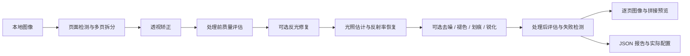

<div align="center">

# DocRestore

**本地文档图像修复与质量评估工具**

面向拍照文档、扫描件和文档处理工作流，提供可配置的修复流水线、逐页质量报告与可追溯的处理结果。

[](https://github.com/rryyyi/image-processing/actions/workflows/tests.yml)
[](pyproject.toml)
[](docs/architecture.md)
[](#快速开始)

[快速开始](#快速开始) · [Python API](#python-api) · [架构设计](docs/architecture.md) · [实验与复现](docs/evaluation.md) · [参与贡献](CONTRIBUTING.md)

</div>

## 项目解决什么问题

手机拍摄与扫描文档经常存在阴影、光照不均、透视变形和多页混排。简单提高亮度容易损伤文字细节、印章和纸面颜色；叠加去噪、锐化等操作也可能使原本清晰的文档退化。

DocRestore 将这些处理组织为一条**本地运行、按场景配置、带质量反馈的流水线**：检测并拆分页面，执行几何与光照修复，按需启用画质增强，输出修复图像、处理前后指标、失败警告和实际使用的配置。可作为 OCR、知识库文档接入或 Agent 文档工具的前处理组件；当前仓库实现的是图像工具及评测体系，尚未包含 OCR 引擎或 LLM/Agent 编排。

### 效果预览


*Jung 配对样本 `jung_01` 的历史实验结果。各列依次为输入、Doc-Image-Tool、DocRestore、DocShadow、Ground Truth；完整评测条件见[实验文档](docs/evaluation.md)。*

## 核心能力

| 能力 | 实现方式 | 可检查的输出或依据 |
| --- | --- | --- |
| 页面理解与几何修复 | OpenCV 页面候选检测、多页拆分、四边形透视矫正；检测失败回退整图 | 每页 `geometry`、`confidence`、`fallback` |
| 光照与阴影修复 | 默认形态学背景估计；可切换 guided、contrast-guided、Retinex、water-filling、paper-guided 估计器 | 光照场、增益图与[估计器实验](results/tables/estimator_summary.csv) |
| 可控画质增强 | 反光、去噪、保守锐化、褪色、划痕模块按配置启用；默认关闭 | [场景预设](configs/scenarios)与[消融结果](results/tables/ablation_summary.csv) |
| 质量反馈与失败提示 | 背景均匀性、边缘能量、噪声、可能反光比例及启发式可读性评估 | 逐页 `before` / `after` / `warnings` |
| 工具化调用 | Typer CLI 与 Python API；图像处理主流程使用 CPU，无需下载模型 | [调用示例](#python-api)、[主流水线](src/docrestore/pipeline.py) |
| 可追溯处理 | 保存实际配置、耗时、页面结果和可选中间图 | `manifest.json`、`effective_config.yaml` |
| 工程验证 | Unicode 路径读写、合成退化测试、真实配对评测与失败分析 | [测试](tests)、[实验脚本](scripts)、[技术决策](docs/decisions.md) |

## 处理架构



光照恢复将亮度增益与纸面颜色校正分开，限制最大增益，并按低饱和度纸面区域混合彩色增益，以减少印章和彩色笔迹的颜色漂移。默认参数来自估计器对照、消融和参数扫描；相关取舍记录在[技术决策](docs/decisions.md)中。

## 快速开始

### 1. 安装

需要 **Python 3.10–3.12**，建议使用 Python 3.12。主流程无需 GPU、PyTorch 或模型权重。

```bash
git clone https://github.com/rryyyi/image-processing.git
cd image-processing
python --version
python -m venv .venv
```

激活虚拟环境，以下任选对应系统的命令：

```powershell
# Windows PowerShell
.\.venv\Scripts\Activate.ps1
```

```bash
# macOS / Linux
source .venv/bin/activate
```

安装主包：

```bash
python -m pip install -e .
python -m docrestore --help
```

也可使用 uv：`uv venv --python 3.12 .venv`，激活后运行 `uv pip install -e .`。以下命令均在仓库根目录、虚拟环境已激活的情况下执行。

### 2. 运行仓库自带示例

以下命令使用已提交的示例页面，不需要额外下载数据。它演示调用流程；这张图已经处理过，不能用来衡量真实修复增益。

```bash
python -m docrestore run results/examples/real_shadow/page_01.png -o results/runs/quickstart --intermediates
```

处理自己的拍照文档：

```bash
python -m docrestore run "path/to/input.jpg" -o results/runs/my-document
```

CLI 当前每次处理一个图像文件；一个文件内可以拆出多页。目录批处理需要调用方自行遍历文件。

### 3. 选择场景与评估方式

```bash
# 手机拍照：guided 光照估计 + 反光、去噪、锐化开关
python -m docrestore run "input.jpg" -o results/runs/phone --config configs/scenarios/phone.yaml

# 扫描件：关闭页面检测和透视矫正，使用温和光照修复与去噪
python -m docrestore run "scan.png" -o results/runs/scanner --config configs/scenarios/scanner.yaml

# 只评估当前图像，输出质量报告
python -m docrestore assess "input.jpg" -o results/runs/quality.json

# 有配准、同尺寸参考图时，额外计算参考指标
python -m docrestore assess "restored.png" --target "reference.png" -o results/runs/reference.json
```

| 配置 | 主要选择 | 使用建议 |
| --- | --- | --- |
| 默认配置 | morphological 光照估计，画质增强关闭 | 先检查这一保守基线的效果 |
| [phone.yaml](configs/scenarios/phone.yaml) | guided，启用反光、去噪与锐化模块 | 拍照文档；模块内部仍受阈值/强度限制 |
| [scanner.yaml](configs/scenarios/scanner.yaml) | 关闭检测/透视，降低光照修复强度，启用去噪 | 已对齐扫描件 |
| [archive.yaml](configs/scenarios/archive.yaml) | contrast-guided，启用划痕与褪色模块，加强边缘保护 | 老旧档案；人工检查小字和纹理 |
| [accessibility.yaml](configs/scenarios/accessibility.yaml) | guided，启用褪色增强，提高对比度 | 低对比文档的可读性探索 |

预设是显式配置策略，当前不会自动识别场景或自动选择模型。`sharpen_amount` 只有在 `restoration.deblur: true` 时才会生效；archive/accessibility 预设当前未开启这个开关。

## Python API

```python
from docrestore import DocumentPipeline, load_config

pipeline = DocumentPipeline(load_config("configs/scenarios/phone.yaml"))
result = pipeline.process_path(
    input_path="results/examples/real_shadow/page_01.png",
    output_dir="results/runs/api-example",
    save_intermediates=True,
)

report = result.manifest()
print(f"pages={report['page_count']}, elapsed={report['elapsed_seconds']:.3f}s")
for page in report["pages"]:
    print(page["index"], page["after"]["readability_label"], page["warnings"])
```

对内存图像调用 `pipeline.process(image)` 时，输入应为 OpenCV 风格的 **BGR、`uint8`、`H × W × 3`** 数组。结果对象保留每页图像和中间数组；`result.manifest()` 返回可序列化摘要。磁盘上的 `manifest.json` 还附加了输入绝对路径与完整配置。

### 输出结构

```text
results/runs/my-document/
├── page_01.png              # 修复后的第 1 页；多页时继续编号
├── combined.png             # 全部页面的拼接预览
├── manifest.json            # 页数、耗时、几何信息、前后指标、警告、输入路径和配置
├── effective_config.yaml    # 合并默认值后的实际配置
└── intermediates/           # 使用 --intermediates 时保存，内容取决于启用模块
    ├── page_01_illumination.png
    └── page_01_gain.png
```

查看已提交的[真实文档输出](results/examples/real_shadow)和[多页输出](results/examples/synthetic_multipage)。可读性标签为 `readable` / `review` / `poor`，属于启发式图像质量提示，不能替代 OCR 准确率或人工验收。

## 与 Agent 工程的联系

这个项目提供了可用于文档 Agent 的工具基础，并以实际工程产物体现以下设计能力：

| 工程关注点 | 当前实现 | 接入上层系统时的用途 |
| --- | --- | --- |
| 清晰的工具边界 | Python API / CLI、单文件输入、配置与结果对象 | 将图像处理封装为独立工具调用 |
| 结构化反馈 | 逐页指标、告警码、严重程度、耗时 | 为上层路由、人工复核与失败分析提供依据 |
| 可诊断执行 | 实际配置、光照场、增益图、反光掩膜 | 回查一次处理使用了哪些参数、在哪个阶段出现问题 |
| 保守处理策略 | 检测失败回退整图、大面积反光拒绝局部补绘、默认关闭外观增强 | 在不确定时给出结果和警告供上层判断 |
| 评测驱动迭代 | 基线、逐图指标、消融、参数扫描、失败排名 | 用实验检查默认策略，定位回归和难例 |

上层 Agent 可以读取 `manifest.json`，把严重警告转为人工复核任务，或者选择另一套配置重新运行。这属于**接入建议**；当前没有实现自动重试、LLM 决策、MCP 服务或多 Agent 协作。更具体的调用边界见[架构文档](docs/architecture.md#agent-工具接入建议)。

## 实验结果

历史基准使用 Water-Filling 仓库提供的 **20 对 Jung 真实配对文档**。下表来自已提交的 [benchmark_summary.csv](results/tables/benchmark_summary.csv)，展示全图指标的逐样本均值：

| 方法 | PSNR ↑（dB） | SSIM ↑ | RMSE ↓ |
| --- | ---: | ---: | ---: |
| 原始输入 | 12.932 | 0.792 | 0.240 |
| Doc-Image-Tool | 15.918 | 0.810 | 0.176 |
| DocShadow | 17.300 | 0.834 | 0.148 |
| **DocRestore** | **18.989** | **0.843** | **0.127** |

在这组样本上，DocRestore 的平均全图 PSNR 相对输入提高 **6.057 dB**，相对 DocShadow 提高 **1.689 dB**。结果仅代表该小规模基准；强阴影、密集版面和复杂图表仍有失败样例，`jung_06`、`jung_09`、`jung_10` 的效果落后于 DocShadow。样本既用于参数选择又用于报告结果，不构成独立留出测试集的泛化结论。

基准为保持参考图对齐，关闭了页面检测；因此不衡量完整页面检测和透视修复的准确率。完整 SD7K 训练/评测未完成，尚未评测 OCR 字符或词错误率。历史计时未构成统一硬件协议，不用于跨方法吞吐排名。区域 SSIM 的现有实现限制及复现依赖详见[实验与复现](docs/evaluation.md)。

相关证据：[逐图指标](results/tables/benchmark_per_image.csv) · [估计器对比](results/tables/estimator_summary.csv) · [消融结果](results/tables/ablation_summary.csv) · [参数扫描](results/tables/sensitivity_summary.csv) · [失败排名](results/tables/failure_ranking.csv) · [技术决策](docs/decisions.md)。

## 开发与验证

```bash
python -m pip install -e ".[dev]"
python -m pytest
```

现有测试包含 16 个测试用例，覆盖 Unicode 读写、五种估计器、合成阴影恢复、参考指标、页面检测与多页拆分、反光保护和大面积反光拒修。`paper_guided` 是额外实现的估计器，当前不在这五种参数化测试中。

GitHub Actions 配置了 Ubuntu/Windows 与 Python 3.10/3.12 的测试矩阵；实际执行状态以页面顶部的工作流徽章及 Actions 日志为准。

实验脚本需要额外准备数据和第三方依赖，不能直接等同于安装主包后的测试。按[复现文档](docs/evaluation.md#复现历史基准)准备好目录后可运行：

```bash
python scripts/run_benchmark.py --methods input,doc_image_tool,ours --save-all --output results/benchmark_local
python scripts/run_estimator_comparison.py
python scripts/run_ablation.py
python scripts/run_param_sensitivity.py
python scripts/analyze_failures.py
```

## 项目结构

```text
src/docrestore/
├── cli.py                  # run / assess 命令
├── config.py               # 默认配置、递归合并与部分参数校验
├── pipeline.py             # 流水线编排与结果保存
├── types.py                # 质量、几何与结果数据结构
├── io.py                   # Unicode 安全图像读写
├── pages/                  # 页面检测与多页候选
├── geometry/               # 透视矫正
├── illumination/           # 背景估计与光照恢复
├── restoration/            # 反光、噪声、锐化、褪色、划痕
├── quality/                # 无参考评估、参考指标与失败检测
└── adapters/               # 可选 DocShadow 对照模型适配
configs/                    # 默认、场景和实验配置
scripts/                    # 基准、消融、分析与报告生成
results/                    # 已提交的指标、对比图和示例输出
tests/                      # 不依赖外部数据和模型的测试
docs/                       # 架构、评测、技术决策与参考记录
.github/                    # CI 与协作模板
```

## 能力边界与后续方向

- 已实现四边形透视矫正；弯曲书页的深度 dewarping 尚未实现。
- 去模糊模块采用保守锐化；饱和反光覆盖的真实文字无法凭空恢复。
- 可读性和反光比例是启发式估计；白纸可能被计入高亮区域，需结合预览检查。
- 主包处理在本机执行；第三方仓库、权重和原始数据需单独获取，并遵守各自许可。
- 配置只做部分校验；当前没有服务端鉴权、输入资源限额、并发隔离或任务队列。
- 后续可评估独立测试集、OCR 下游增益、布局感知保护，以及在服务层封装 Agent/MCP 工具；这些尚未交付。

项目当前未附开源许可证。使用、修改和分发本项目代码前，请先与维护者确认授权；第三方材料遵守其各自许可。

## 深入阅读与协作

- [架构与输出契约](docs/architecture.md)：模块职责、输出字段、告警与接入注意事项。
- [实验与复现](docs/evaluation.md)：数据准备、指标、结果限制和脚本副作用。
- [技术决策](docs/decisions.md)：默认估计器、边缘保护、彩色增益和增强开关的选择依据。
- [研究参考与复现记录](docs/references.md)：第三方来源、版本与实际运行范围。
- [历史实验日志](docs/experiment_log.md)：原实验环境、迭代和运行记录。
- [贡献指南](CONTRIBUTING.md)：开发环境、验证方式和结果提交规范。

欢迎通过 [Issues](https://github.com/rryyyi/image-processing/issues) 提交可复现问题或改进建议。
