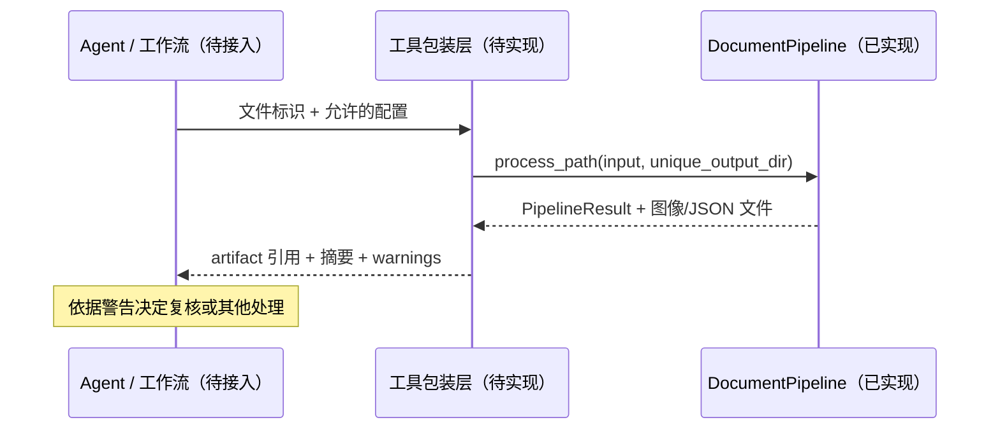

# 架构与输出契约

DocRestore 是本地、同步执行的文档图像工具。入口为 `DocumentPipeline` 和 CLI，主要依赖 NumPy、OpenCV、SciPy 与 scikit-image。本文描述当前实现；Agent 服务化建议单独标注。

## 模块与处理顺序

| 阶段 | 代码 | 行为 |
| --- | --- | --- |
| 配置 | [config.py](../src/docrestore/config.py) | 将用户配置递归合并到默认值；校验估计器名称、最大增益、最大页数等部分参数 |
| 页面检测 | [pages/detect.py](../src/docrestore/pages/detect.py) | 找到页面候选，限制页数，抑制小区域；无可靠边界时回退整图 |
| 几何修复 | [geometry/rectify.py](../src/docrestore/geometry/rectify.py) | 对符合条件的四边形页面做透视变换 |
| 修复前评估 | [quality/assess.py](../src/docrestore/quality/assess.py) | 在几何处理后的页面上计算 `before` 指标 |
| 反光处理 | [restoration/glare.py](../src/docrestore/restoration/glare.py) | 按开关检测小面积反光并局部补绘；大面积区域拒绝补绘 |
| 光照修复 | [illumination/restore.py](../src/docrestore/illumination/restore.py) | 估计背景、恢复亮度，按纸面掩膜混合彩色增益 |
| 可选增强 | [restoration/](../src/docrestore/restoration) | 顺序执行去噪、褪色增强、划痕修复、保守锐化；默认全部关闭 |
| 修复后评估 | [quality/assess.py](../src/docrestore/quality/assess.py) | 计算 `after` 指标 |
| 失败检测 | [quality/failure.py](../src/docrestore/quality/failure.py) | 检查边缘损失、残余反光、模糊等情况，生成结构化警告 |
| 输出 | [pipeline.py](../src/docrestore/pipeline.py) | 返回页面结果、拼接预览和耗时；文件入口额外保存图片、JSON 与 YAML |

`before` 是几何处理后的页面质量，不是原始整图的质量。因此它适合与同一页的 `after` 对比，不能直接代表几何修复的收益。

## 配置模型

```python
from docrestore import DocumentPipeline, PipelineConfig

config = PipelineConfig.from_mapping({
    "pages": {"enabled": False},
    "illumination": {"estimator": "morphological", "max_gain": 2.8},
    "restoration": {"deblur": False},
})
pipeline = DocumentPipeline(config)
```

`PipelineConfig.from_mapping()` 会深复制默认值并递归覆盖，`load_config(path)` 从 YAML 加载覆盖值。直接 `DocumentPipeline()` 使用代码内的默认配置；根目录的 [configs/default.yaml](../configs/default.yaml) 是可显式加载的配置文件，修改它不会自动修改代码默认值。

配置并非完整的 schema 校验器：未知键、类型和数值范围没有全部严格验证。外部服务应先校验允许的字段和值，再构造配置。模块开关和强度分别生效，例如设置 `sharpen_amount` 不会自动打开 `deblur`。

光照估计器支持 `morphological`、`guided`、`contrast_guided`、`retinex`、`water_filling`、`paper_guided`。默认值与实验取舍见[技术决策](decisions.md)。

## Python 接口

```python
DocumentPipeline(config=None)
pipeline.process(image)
pipeline.process_path(input_path, output_dir, save_intermediates=None)
```

- `config` 可以为 `PipelineConfig`、映射或 `None`。
- `process(image)` 输入为 BGR、`uint8`、`H × W × 3` 的 NumPy 数组，返回 `PipelineResult`，不会写文件。
- `process_path(...)` 使用 Unicode 安全的文件读写并保存结果，返回相同类型的对象。
- Python 文件入口的 `save_intermediates=None` 遵循配置；显式 `True/False` 覆盖配置。CLI 会始终传入 `--intermediates` 的布尔值，因此 CLI 需显式加此选项才保存中间图。
- 读写错误和参数错误向调用方抛出异常，当前没有统一的工具错误 envelope 或自动重试。

### 内存结果

| 对象 | 主要字段 | 说明 |
| --- | --- | --- |
| `PipelineResult` | `pages`, `combined`, `elapsed_seconds` | 每页结果、拼接预览、处理耗时 |
| `PageResult` | `index`, `image`, `geometry`, `before`, `after`, `warnings`, `intermediates` | 每页图像与诊断数据 |
| `PageGeometry` | `quad`, `bbox`, `confidence`, `source_size`, `fallback` | 检测几何信息；confidence 为检测启发式分值，未经概率校准 |
| `Quality` | 背景、光照、边缘、噪声、对比度、反光、裁切和可读性指标 | 字段定义见 [types.py](../src/docrestore/types.py) |

`PageResult.index` 从 **0** 开始；文件名 `page_01.png` 从 **1** 开始。中间图的键由实际启用的模块决定，不应假设每次都有同样的字段。

### Manifest

`result.manifest()` 返回以下键结构。磁盘 `manifest.json` 在此基础上增加 `input` 和 `config`：

```text
page_count: integer
elapsed_seconds: number
pages: array
  index: integer
  geometry: {quad, bbox, confidence, source_size, fallback}
  before: Quality fields
  after: Quality fields
  warnings: [{code, message, severity}]
input: string                 # 仅磁盘 manifest；本机输入绝对路径
config: object                # 仅磁盘 manifest；合并后的完整配置
```

`Quality` 的 `readability_score` 是 0–100 的启发式分数，标签阈值为 `readable >= 70`、`review >= 45`、否则 `poor`。它综合清晰度、对比度、光照均匀性、噪声和可能反光比例，没有通过 OCR 标注或人工阅读测试做校准。

输出格式目前没有版本字段，也不是单独发布的稳定 schema；集成方应固定代码版本并对所使用字段做检查。现有完整输出见[样例 manifest](../results/examples/real_shadow/manifest.json)。

## 警告与失败处理

| `code` | 默认触发条件 | `severity` |
| --- | --- | --- |
| `page_fallback` | 检测回退且置信度为 0；主动关闭检测不会产生同样的告警 | `warning` |
| `edge_loss` | 处理后/处理前边缘能量比低于 0.72，可配置 | `warning` |
| `glare_residual` | 处理后可能反光比例高于 0.08，可配置 | `warning` |
| `highlight_clipping` | 高亮裁切比例高于 0.12 | `warning` |
| `severe_blur` | Laplacian 方差低于 0.0003 | `error` |
| `readability_poor` | 启发式可读性标签为 `poor` | `warning` |

`error` 是结果报告的严重程度，当前不会据此自动抛异常或让 CLI 返回非零退出码。CLI 打印页数、耗时、分数和警告数量；自动化验收应读取 JSON 中的具体警告。

高亮白纸可能被算入可能反光区域；检测到风险不意味着必然损坏，缺少警告也不保证结果正确。对于合同、档案和小字号文档，需保留原图并检查预览。补绘不会恢复被饱和反光覆盖的真实文字。

## 输出与耗时的解释

- `process()` 的计时包含检测、修复、质量评估和拼接预览；不包含文件读取和最终写盘。
- 基准 CSV 的计时在调用方法外层记录，可能覆盖不同范围；不能与 manifest 耗时直接混为同一指标。
- 保存中间浮点数组时可能进行 min/max 可视化归一化。PNG 适合诊断观察，不能作为原始数值数组反算。
- 同一输出目录会覆盖同名文件；页数减少时旧的额外页面文件不会自动清理。每次任务应使用新的目录。
- manifest 含本机输入绝对路径。分享诊断输出前应检查路径、图像和配置中是否有不宜公开的信息。

## Agent 工具接入建议

以下是上层集成建议，尚未实现为服务或 Agent 运行时：



包装层宜只返回 artifact 标识、页数、质量摘要和告警，避免把图像数组塞进模型上下文。调用方可使用 `severe_blur` 等信号请求人工复核，或用事先验证过的另一套配置重试；重试次数、是否接受结果和归档策略均需由上层实现。

当前流水线会重设 NumPy/OpenCV 全局随机种子，没有线程级状态隔离；同步执行也没有超时、资源上限或任务队列。生产服务需要在包装层补充输入尺寸限制、路径约束、异常映射、独立任务目录和进程隔离，并评估实际并发行为。主包处理过程中不调用在线 OCR 或云端图像服务。
